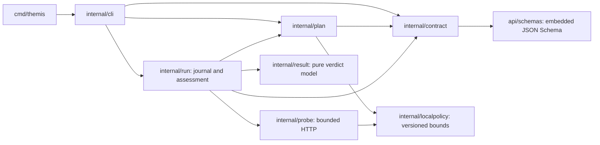

# Architecture

## T0 observation path

Themis is a single executable with small domain packages. The CLI is the adapter
for process arguments, local file reads and terminal output. Domain packages
depend on values and readers, not CLI flags or infrastructure clients.

`contract.Parse` bounds untrusted input, inspects the YAML syntax tree, validates
against the embedded schema, applies explicit defaults and semantic checks, and
freezes a normalized snapshot and SHA-256 digest. A `contract.Validated` cannot be
constructed with arbitrary exported data. Its zero value cannot be planned.
Snapshots and serialized output are independent copies.

`plan.Compile` only consumes that validated snapshot. It freezes the full contract
and planning requirements into deterministic JSON. No I/O-capable adapter is
injected into planning because the preview has no execution responsibility. The accepted target is a
declared local endpoint; resolving a live runtime identity without a trusted
runner would misrepresent the available evidence.

`result` separates execution status/errors from contract verdicts. It takes the
trusted required assertion IDs separately from collected results, so omitted
required outcomes and duplicate/conflicting results cannot silently pass.
Credible required FAIL dominates, then INCONCLUSIVE, then NOT_RUN; only all
required PASS with sufficient evidence and run prerequisites yields PASS.
No required IDs yields NOT_RUN. Optional results stay visible to the caller but
do not affect aggregation. Missing/invalid evidence, unknown verdicts, tool
errors and missing intervention proof block PASS. An explicit NOT_RUN result
preserves that status unless a stronger required result dominates.

Execution status is independent: a tool error is not a measured requirement
failure, and a successful process is not a contract PASS. Future cleanup/unsafe
execution status must also remain visible even if assertion evidence passed.
The local runner records these execution outcomes separately from assessment.

`run.Execute` consumes a validated frozen contract and compiles the exact current
plan. It checks approval and sampling feasibility before I/O, persists the start
manifest, then collects sequential HTTP observations. A small append-only event
state machine accepts `started`, ordered `sample` events and a single `finished`
event. Signal cancellation stops requests and preserves a terminal record when
possible. No destructive resources or restart actions exist.

`probe` owns a bounded private HTTP client. `localpolicy` shares versioned timing
and header limits between planning and execution. `run.Replay` revalidates inputs,
plan identity and event timing, then derives evidence from observations before
calling the pure aggregator. Live reports use the same path as offline replay.
Provider-supplied verdicts and evidence flags are not trusted inputs. See
[run semantics](runs.md) for coverage, unsigned provenance and crash limitations.

## Dependencies

The standard library handles the CLI, streams, URL/duration validation, JSON and
SHA-256. The T0 parsing dependencies are
[go-yaml v3](https://github.com/yaml/go-yaml/tree/v3.0.5) for YAML syntax nodes and
[jsonschema v6](https://github.com/santhosh-tekuri/jsonschema/tree/v6.0.3) for actual
Draft 2020-12 schema validation. The stable v3 YAML API is chosen instead of a
v4 release candidate; migration can follow a stable release and conformance tests.
`golang.org/x/text` is transitive through schema error localization.

T1.1 additionally uses `golang.org/x/sys/windows` v0.49.0 to set and inspect
Windows ownership and protected DACLs. Unix ownership and modes use the standard
library. No POSIX-mode-only confidentiality claim is made on Windows.

These libraries avoid an incomplete hand-written YAML or schema engine. The
schema is embedded and compilation uses a loader that rejects external resources.
Go 1.26.9 is the minimum after the new HTTP call graph exposed standard-library
advisories in the previous 1.26.8 toolchain. CI selects the latest
available 1.26 patch.
There is no CLI framework, database, Kubernetes/cloud SDK, provider client or
observability dependency. Diagnostics use escaped terminal errors; run events
are structured JSON records.

## Delivery boundary

T-001–T-008 have local implementations, including real synthetic measurements,
deterministic PASS/FAIL replay fixtures and unsigned structured reports. The
T0 diff, ADRs and test evidence have received the review authorizing T1.1.
Loopback selection does not authenticate a process or isolate a fault target.
Experimental T1.1 implements those boundaries only for a disposable owned local
fixture. See [experiment architecture and limitations](experiments.md).

See the [decision records](adr/README.md) for scope and integrity decisions.

## Experimental T1.1 interfaces

`contract.ParseExperiment` returns a distinct immutable v1alpha2 value.
`plan.CompileExperiment` freezes that value with an already authenticated
`FixtureIdentity`. `safety.Evaluate` denies unsupported scope and bounds;
`safety.CheckAuthorization` checks actor, digest, instance and expiry binding.
Neither evaluator mints a capability. The fixture authority recompiles the exact
plan, mints a sealed grant after explicit approval, then enforces single-use claim
and idempotent application across real process/network boundaries.

`fixture.Start` launches the independent owned process; `fixture.Client` handles
nonce identity proofs and authenticated scoped control/data calls.
`experiment.Execute` persists a private resource inventory and versioned journal
before mutation. The client observer measures paired direct/proxy/application
traffic, and assessment uses `result.Aggregate` with trusted required IDs.
`experiment.Replay` validates and recomputes; `experiment.Reconcile` removes only
the exact inventoried resource and records fresh residual checks without rewriting
history. The one concrete proxy needs no general plugin interface. Detailed
lifetimes, evidence predicates, crash boundaries and limitations are in the
[experiment guide](experiments.md).

## T1.2 lifecycle interfaces

`experiment.Inspect` reads the validated journal prefix, protected inventory,
immutable receipts and current resource observations without creating records or
consuming control nonces. `experiment.Cancel` and `ReconcileContext` share a
scoped action protocol, separate from historical measurement assessment.
`runner.lock` expresses actual runner liveness; `lifecycle.lock` serializes action
acceptance with fault admission and finalization. The worker independently
enforces an irreversible quiescence fence. Neither lock owns the fault timer.

The only new execution test interfaces wrap actual journal writes/syncs,
immutable record publication and the standard HTTP round trip. Production uses
concrete local files and the existing bounded transport. No general scheduler,
provider registry, database or controller framework is introduced.

The new experiment journal/report versions are v1alpha2, while contract/plan
formats and policy/adapter bounds remain unchanged. Legacy v1alpha1 experiment
journals have their own transition rules and report shape. See
[T020–T022](adr/README.md) and [lifecycle details](experiment-lifecycle.md).

## Kubernetes dry-run boundary

T2.0 has its own API projection/policy in `api/kubernetes` and `internal/kube`.
`cmd/themis-controller` watches one namespace and writes only VerificationRun
status. Fresh API reads feed immutable planning; no local fixture grant or OS
lock becomes cluster authority. The runner/observation/assertion path is uninvoked,
so a preview remains NOT_RUN. [Kubernetes architecture](kubernetes.md) and ADRs
T023-T028 describe UID pins, RBAC, versioning and future authorization requirements.

## Owned Kind execution boundary

T2.1 adds `cmd/themis-kube`, `internal/kubeexperiment` and the independent
`internal/kubefault` protocol/fixture executable. The runner reads Kubernetes
through restricted credentials and uses an exact-Pod port-forward to the
preinstalled fixture. It independently recompiles the preview, freezes the live
owner chain and container/boot identities, and requires a separate signed
execution grant. The T2.0 API, controller and its RBAC remain unchanged.

The fixture enforces authenticated single-use application, independent monotonic
expiry and distinct bounded cleanup authority. The runner journals durable
intent, collects paired client measurements plus signed per-request proxy holds,
evaluates the existing pure result semantics, verifies recovery and reports
cleanup independently. Protected inventory and immutable reconciliation receipts
preserve history across process death/corruption. No local OS authorization grant
becomes cluster authority; private-file helpers only protect state. See
[the execution guide](kubernetes-experiments.md) and ADRs T029–T035.

## T2.2 Kubernetes lifecycle

The same concrete runner adds `Cancel`, `Inspect`, `Reconcile`, and
`VerifyEvidence`. Protected inventory and a short OS lifecycle gate order durable
stop acceptance with Apply and finalization. Fixture-side fencing/expiry stays
independent. Cleanup can reconnect to an unchanged original boot after generation
drift, without resolving a replacement or permitting another execution.

Inspection separates historical replay and unsigned saved claims from current
signed state. Offline verification supplements hash checks with strict bindings,
lifecycle, correlations and signature checks, then reuses the pure evaluator.
Candidate PASS never becomes trusted execution PASS offline. New lifecycle
artifacts are v1alpha2; legacy replay and T2.1 plans/grants stay compatible.
No generic workflow engine or new Kubernetes execution resource exists. The
[lifecycle guide](kubernetes-lifecycle.md) and ADRs T036–T042 describe the protocol,
limits, live adversarial tests and deferred controller/runner integration.

## T2.3 operator coordination

`internal/kubeexperiment/coordination*.go` connects independently reconstructed
request/preview/plan to explicit approval and the existing engine. New versioned
operational records reference unchanged execution journals and reports; no second
verdict source exists. A durable one-use claim prevents restart/retry application.
An outer operator gate orders stop acceptance even before run inventory exists;
the existing inner gate retains compatibility with individual cancellation.
Missing protected execution inventory never authorizes guessed cleanup. Controller,
API, RBAC and fault scope remain unchanged. Read and mutation replay budgets in
the fixture are independently bounded. See [workflow](kubernetes-coordination.md)
and ADRs T043-T049 for provenance, crash behavior and future native ownership.

## T2.4 external-provider planning boundary

`internal/chaosmesh` and `cmd/themis-chaosmesh` add a concrete read-only planner
and versioned denied admission for one researched NetworkChaos delay. They reuse
the actual Kubernetes preview compiler and bounded JSON utilities. Both working
synthetic engines and the controller remain unchanged. Source audit found missing
approved-UID enforcement and no demonstrated independent hard expiry, so the
explicit planning-only fallback is implemented. No second executor, grant issuer,
provider registry, generic mutation interface or evaluator is created. See
[the safety audit](chaosmesh.md) and ADRs T050-T054.
## PostgreSQL recovery boundary

`cmd/themis-postgres` and `internal/postgres` add one concrete local logical
backup/restore workflow. Contracts, frozen plans, database-specific grants,
Docker ownership checks, host COMMIT receipts, private archives and measured
restored application checks remain inside this package. It reuses only
`localstate` protection/locking and pure `result` aggregation. It imports no
Kubernetes engine and changes no existing provider interface or RBAC.
See [the recovery architecture and limitations](postgres-recovery.md).
## Durable PostgreSQL workflow (T3.1)

The concrete `internal/postgres/durable_*` implementation introduces an explicit
second contract, plan, authority and report format. The existing T3.0 commands
and wire formats retain their defaults. `cmd/themis-postgres/durable.go` dispatches
only the new `durable` namespace; no database-provider registry is added.

Installation creates two owned persistent volumes and seals the original
inventory. Preparation requires its own grant, commits the synthetic source,
publishes signed host receipts and validates/syncs an independent host archive.
Only then can a second grant bind SIGKILL once to that actual archive digest and
exact original source identity. The runner observes stopped state independently,
restores to the fresh distinct destination, verifies actual application behavior,
and compares reloaded receipts. Independent cleanup ignores execution journals
as authority and preserves historical bytes. See
[durable recovery](postgres-durable-recovery.md) and ADRs T063–T066 for storage,
clock and provenance limits and deferred physical/WAL/failover methods.
