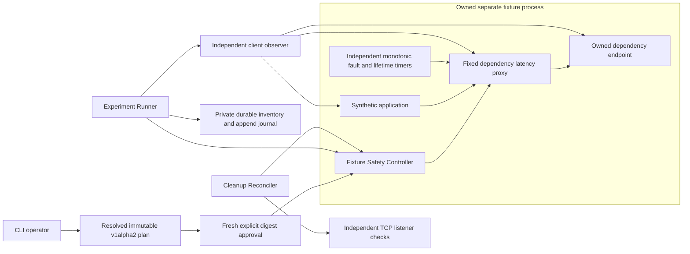

# Experimental owned latency experiments

T1.2 retains the T1.1 scope and thresholds below. Its lifecycle changes are
specified in [lifecycle and recovery](experiment-lifecycle.md).

T1.1 deliberately affects one disposable synthetic application. It supports no
external URL, arbitrary program, production service, host networking mutation,
container platform, cloud resource or general provider interface. Run only on a
local filesystem that enforces the current user's private access controls.

## Components and trust



`internal/safety` owns deny-by-default policy independently of contract fields.
`internal/fixture` implements the one concrete service, proxy and authority in a
separate process. `internal/experiment` implements the runner, client observer,
versioned state machine, assessment, replay and reconciler. There is no workflow
engine, provider registry or speculative adapter interface.

The current OS user and host identify the local actor. Windows uses the process
token SID, actual file owner and an exact owner-only protected DACL through
`x/sys/windows`; Unix checks owner UID, private modes and file type. Private
state creation fails closed when access controls cannot be established. New
immutable files are written to an owner-only temporary file, synced, and
published with an atomic no-replace hard link. Supported storage needs hard
links (tested local NTFS and Linux ext4). Directory entries are synced on Unix;
Windows file data is flushed without claiming POSIX directory-fsync durability.

Fixture and run directories contain credentials and authorization records. Do
not publish or upload them wholesale. The journal and report exclude reusable
control/data tokens and authorization seals. Keep private state outside a shared
directory; WSL `/mnt/...` mounts without Unix permission enforcement are rejected.
Use `/tmp` or your Linux home directory in WSL.

The fixture allocates three distinct `127.0.0.1:0` listeners itself. Plans bind
the actual fixture, service and proxy IDs, endpoints, PID, owner, expiry, adapter
version and response verification key. A fresh nonce identity proof authenticates
the instance before planning and every control operation. Control requests use
HMACs over the exact body digest, path, nonce and fixture ID; responses also bind
the nonce. The control key is never sent over HTTP. A bounded nonce registry
rejects replay (4096 control operations per fixture; exhaustion denies further
control operations, while independent expiry continues). Data credentials are
separate read-only capabilities for fixed synthetic paths.

The authority recompiles and checks the exact resolved plan before minting an
authorization. It binds digest, actor, all target identities, allowed action,
adapter version, issue time and expiry. Authorization expires after 20 seconds
and can claim one run once. The authority's in-memory grant and seal must match;
editing a JSON authorization file cannot authorize an action. This is a local
capability boundary: same-user processes can read the keys and administrators
can bypass these protections. It does not authenticate a human independently of
their OS account or supply enterprise policy enforcement.

## Trusted bounds

| Limit | Enforced value |
| --- | --- |
| Profile and target | `owned-local-test`, one `owned-local-http` fixture |
| Action and concurrency | `http.response-latency`, one claimed run/fault per fixture |
| Additional latency | 150–300ms |
| Fault duration | At most 3s |
| Experiment observation budget | At most 15s |
| Fixture lifetime | 15s–2m, independent process timer |
| Baseline / recovery | 300ms–3s each; 3–20 planned samples each |
| Intervention samples | 3–20; at least 3 independently confirmed requests |
| Slot spacing | Baseline/recovery at least 50ms; intervention at least latency + 50ms |
| HTTP client deadline | 750ms and the phase deadline, whichever is earlier |
| Response body | 4KiB for signed synthetic data |
| Headers | Transport 8KiB; server `MaxHeaderBytes` 8KiB plus Go's bounded parser buffer |
| Connections and work | 32 accepted connections per listener; 16 concurrent data handlers |
| Control input | 128KiB; 1s read/header and 2s write timeouts |
| Cleanup | Independent context, at most 2s per attempt |

Clients disable environment proxies, redirects, compression and connection
reuse. The proxy forwards only `/dependency` to its own allocated service
listener. Faults affect only authenticated synthetic dependency requests. The
application `/work` endpoint calls that proxy: healthy mode tolerates 750ms;
buggy mode has a deliberate 50ms dependency timeout and returns signed HTTP 503.
These paths accept only GET and unpredictable bounded request IDs.

## Independent evidence and verdicts

Each planned slot makes concurrent direct-dependency, proxied-dependency and
application requests with a shared unique correlation ID. The fixture signs
bounded response identity, request/dependency ID, kind and status using Ed25519.
The plan binds its public key. This prevents a replacement listener from
fabricating observations with only public instance IDs or a captured read token.

The client measures monotonic start/completion times. A complete low-latency
baseline is required. A confirmed intervention request needs valid signed direct
and proxy responses, a direct latency no greater than one quarter of the requested
delay, and paired excess latency above the largest baseline excess by at least
three quarters of the requested delay. At least `minConfirmed` requests must
qualify. Adapter receipts and counters cannot satisfy this predicate.

All planned slots and full phase windows must be observed for PASS. Missing or
invalid signatures, identities, samples, planned windows or recovery measurements
block PASS. Recovery requires confirmed removal, successful signed responses and
return to the bounded baseline latency range. A dead proxy supplies no such
recovery evidence. `maximumErrorFraction` uses exact decimal rational comparison:
equality passes; observed failure fraction strictly greater than the limit fails.
A lower bound based on signed failures can establish FAIL even with other missing
samples. A signed application failure after removal violates required recovery.

Verification verdict and execution status are separate. PASS requires verified
intervention, complete evidence, required assertions, observed recovery and
durably recorded cleanup. Credible application/recovery FAIL remains visible
when other checks are inconclusive. Cleanup failure always sets execution to
`CLEANUP_PENDING` and exit 7, even if the separate verdict is FAIL.

Paired latency is empirical evidence under tested conditions. Scheduling, CPU
contention and shared loopback resources can confound it. The observer runs in
the CLI, not a separately trusted host. Response signatures authenticate fixture
messages, not client timings, software honesty, operator identity or a whole
journal. A same-user writer can forge a consistent complete journal, including
new keys and plans. Offline replay does not establish provenance or causal
certainty. T0 remains unsigned with its historical semantics.

## State machine and crash consistency

Normal non-sample transitions are:

```text
RUN_AUTHORIZED → BASELINE_STARTED → BASELINE_COMPLETED
→ FAULT_REVALIDATION_STARTED → FAULT_INTENT_RECORDED → FAULT_APPLIED
→ INTERVENTION_STARTED → INTERVENTION_CONFIRMED | INTERVENTION_UNVERIFIED
→ FAULT_REMOVAL_REQUESTED → FAULT_REMOVED | FAULT_REMOVAL_UNKNOWN
→ RECOVERY_STARTED → RECOVERY_OBSERVED | RECOVERY_UNVERIFIED
→ CLEANUP_STARTED → CLEANUP_COMPLETED | CLEANUP_PENDING → RUN_FINALIZED
```

Cancellation, timeout or infrastructure errors transition active states to
`ABORTED`, then attempt cleanup and finalization. Samples are allowed only in
their matching collection state, with fixed ordered slots and distinct request
IDs. Replay validates versions, exact recompiled plan/digests, authorization
metadata, run/resource identity, state transitions, request ordering and timing.
It recomputes assertions from measurements rather than saved verdicts or state
labels. Empty, partial, trailing, duplicate-key and corrupt records fail closed.
Missing terminal records remain unresolved, never successful completion.

Before `Apply`, the runner syncs a private `resources.json` containing the frozen
plan, redacted authorization metadata, fixture reference, exact handle and expiry.
It syncs the append-only authorized manifest and fault intent. Every event write
is followed by `File.Sync`. The fixture claims one run exclusively; duplicate
apply calls inspect the original receipt without extending or recreating a
removed/expired fault. A crash between apply and its acknowledgment is ambiguous
in the journal. The durable handle permits safe removal; expiry does not depend
on reconstructing the missing acknowledgment.

The report represents `faultAttempted` as `null` when durable intent lacks an
application acknowledgment. It does not turn that uncertainty into `false`.

In T1.2 baseline admission and fresh target/authorization revalidation precede
intent. Known rejection before sending Apply is `false`; a transport failure
after intent remains `null`; an authenticated matching acknowledgment is `true`.
A failure diagnostic preserves known application state when the journal itself
cannot be appended. Historical T1.1 journals retain their original semantics.

Fault delay and removal channels have a monotonic deadline no later than three
seconds after application or the experiment lease deadline. Each request checks
that deadline; its delay also ends on removal, expiry or request cancellation.
Timers hold no filesystem/network operation under the fault mutex. Blocked CLI
disk writes cannot extend the intervention. If the process is suspended, it
cannot serve delayed traffic; on resumption requests check the elapsed deadline.
The fixture's independent lifetime closes all listeners within its configured
bound, subject to normal OS scheduling. No persistent networking rule exists.

Normal cleanup removes the fault, collects recovery evidence, stops the owned
fixture, then attempts TCP connections to all three listeners. Only actual
connection-refused errors count as closed. Timeouts or replacement listeners
remain pending. The reconciler never kills a PID or sends credentials to an
unproven target. Cleanup uses a separate timeout after cancellation.

`experiment cleanup --run <directory>` uses the protected pre-mutation inventory
and exact fresh instance proof, independently of journal validity. It writes a
new cleanup receipt and preserves the original journal/report. Retries are
idempotent. Already-closed listeners establish resource cleanup only, not
application recovery or a retrospective PASS. A corrupt/missing inventory is
not guessed from partial events: preserve evidence, report pending/error and
allow independent expiry. No automatic resume or fault reapplication exists.

Storage can still block a CLI or reconciliation operation beyond its context
deadline. Expiry is independent of it. Power-loss disk persistence is not proven
by process-kill tests; losing power also removes this process-only fault.
Windows and Linux process-kill behavior is covered by integration tests; macOS
runtime/crash behavior has not been validated in this environment.

## Reproduce and inspect

See [CLI commands](cli.md) and [the example](../examples/owned-latency/README.md).
The integration suite builds an actual CLI executable (with `-race` in a race
test run), kills it after observing application, waits for guardian expiry, sends
real post-expiry traffic, checks interrupted replay, corrupts the journal and
reconciles via the private inventory. It separately kills the fixture process and
checks that resource disappearance is not reported as application recovery.
The [negative matrix](t11-test-matrix.md) defines the expected outcomes.
T1.2 extends this with the [lifecycle validation matrix](t12-test-matrix.md).
