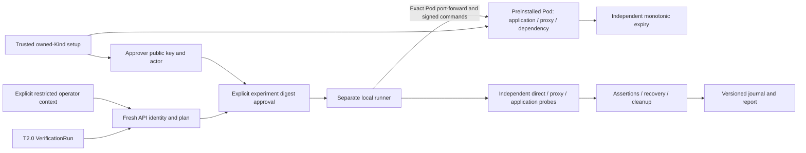

# Owned Kind latency experiments (T2.1)

Experimental, single-operator synthetic scope. T2.0 remains a non-destructive
preview controller. `themis-kube` is a separate local runner with a different
authorization protocol and artifact versions. Neither a VerificationRun nor
its unsigned status authorizes a fault.



The target is one operator-installed `latency-fixture` Deployment/Pod in
`themis-test`. It runs non-root without a Kubernetes token, host networking,
privileges, shell, arbitrary upstream or writable root filesystem. The proxy
adds only 150–300ms response latency for an approved 1.5–3 seconds. This is not
packet loss, network partition, pod disruption or production chaos.

## Prerequisites and owned environment

Use Go 1.26.9+, Docker with Linux containers, kubectl, PowerShell 7 on Linux or
Windows PowerShell, and Kind 0.32.0 installed in `.cache/tools/kind[.exe]`.
The validated environment is Windows/WSL with Linux amd64 containers. Other
platforms need their own runtime validation. Installation needs local Docker and
administration of the **new** disposable cluster; execution uses a restricted
service account. No AWS, external product or ambient kubeconfig is needed.

```powershell
New-Item -ItemType Directory -Force .cache/tools | Out-Null
$env:GOBIN = (Resolve-Path .cache/tools).Path
go install sigs.k8s.io/kind@v0.32.0
./scripts/kind-experiment.ps1 -Action up
```

Setup refuses an existing `themis-t21` name or state directory. It records prior
cluster names, creates an explicit private admin kubeconfig, records live
`kube-system` and `themis-test` UIDs, and checks them before subsequent mutations.
It installs the unchanged T2.0 CRD/policy/RBAC/controller and synthetic example,
the fixture, exact-Pod runner RBAC and `latency-request` preview. It does not
change the global context or adopt unrelated clusters.

Kind's node image is pinned in `examples/kubernetes-experiment/kind.yaml`. Local
scratch images are built from the source, tagged by binary SHA-256, loaded into
the owned node and assigned an immutable manifest reference. Setup separately
pins the declared OCI image reference and actual runtime image ID. Containerd
may report a selected platform manifest rather than the parent OCI index.

The test controller manager uses a five-second resource-quota resync. Setup
waits for both built-in and VerificationRun quota usage initialization. A ready
Pod quota alone does not establish readiness of a newly discovered CRD counter.
Failure stops setup before experiment authority is available. This setting is
confined to the new disposable Kind control plane.

Private `.themis/kind-t21` holds admin/operator configs, ownership, approval key,
per-invocation capabilities and run inventories. Its scoped operator token lasts
one hour. Keep the directory private and exclude it from reviews. The public
fixture config contains only pins, permitted actor and approver public key; the
fixture signing key is boot-local memory. The installed workload has no Secret
or API access.

## Plan, approve and execute

Windows uses `.cache/themis-kube.exe`; Linux uses `.cache/themis-kube`. Setup
builds that executable. The following commands explicitly authorize one healthy
synthetic experiment. Run approval and execution consecutively: first Apply must
reach the fixture within 20 seconds.

```powershell
$state = (Resolve-Path .themis/kind-t21).Path
$runner = (Resolve-Path .cache/themis-kube.exe).Path
$planJSON = & $runner plan --state $state --run latency-request --scenario healthy
[IO.File]::WriteAllText((Join-Path $state 'plan.json'),
    (($planJSON -join "`n") + "`n"), [Text.UTF8Encoding]::new($false))
$preview = Get-Content -Raw -Encoding UTF8 (Join-Path $state 'plan.json') | ConvertFrom-Json
# Inspect the complete experiment plan and exact digest before approval.
& $runner approve --state $state -f (Join-Path $state 'plan.json') `
    --approve-digest $preview.digest --out (Join-Path $state 'authorization.json')
& $runner run --state $state -f (Join-Path $state 'plan.json') `
    --authorization (Join-Path $state 'authorization.json')
```

The plan file is public input. Approval capability files are created with
protected permissions and never overwrite an existing record. Use new filenames
and fresh approval for a new invocation. The initial contract requires exactly
three samples per phase, three independent intervention confirmations and zero
application errors. Fault parameters are part of the complete approved digest.

Supported synthetic scenarios are `healthy`, `buggy`, `noop`, `cleanup-denied`.
Scenario selection is explicit in both plan and signed grant. It controls only
the instrumented fixture's deliberately implemented demo variants. `buggy`
returns 503 instead of graceful fallback when the proxy is slow. `noop`
acknowledges Apply without adding delay, which must remain INCONCLUSIVE.
`cleanup-denied` rejects immediate Remove while active; independent expiry is
unchanged, and the run must report CLEANUP_PENDING/exit 7.

## Identity and authorization

The runner authenticates with a fresh Kubernetes SelfSubjectReview and verifies
the configured service-account name **and UID**. It recompiles the preview from
fresh API objects and freezes the run UID/generation, Deployment UID/generation,
template digest, ReplicaSet owner, Pod name/UID/spec, running container/image,
cluster/namespace UIDs and boot-specific proxy/response key. Exactly one ready
target instance is required. Namespace, actor, action and duration are fixed or
hard bounded by independent policy, never relaxed by the requested spec.

Approval signs a separate versioned execution grant. It binds the entire plan,
one-time invocation ID, exact parameters, expiry and distinct Apply/cleanup public
keys. A public preview/grant has no command-signing key. All fault commands need
the appropriate private key, fresh signed nonce and matching fixture identity.
Apply is single-use; a repeated call returns the original receipt and deadline,
including after removal/expiry. An ambiguous acknowledgement is not retried as
a new effect. Remove before Apply fences the invocation permanently.
Damaged or mismatched private Apply/cleanup keys are rejected before execution.

Port-forwarding binds the exact Pod name on port 8080, never a Service selector.
The local listener is randomly allocated on 127.0.0.1. Reads bracket connection
setup, a nonce handshake verifies the approved boot key, and fresh API/fixture
revalidation occurs after durable intent immediately before Apply. A new Pod,
container restart, changed template/owner/image/contract or different run cannot
reuse the grant. There is no automatic forwarding to a replacement endpoint.

The Kubernetes port-forward API has no UID precondition and cross-object reads
are not atomic. The runner detects replacement and rechecks after Apply; the
fixture independently checks its actual Downward API UID and boot identity.
This assumes honest installed software, Kubernetes/Docker administrators and
the local approval-key holder. It does not establish production authorization,
independent human approval, instantaneous revocation of already open streams,
multi-tenant isolation or remote execution attestation. Local file locks and
ACLs protect state/coordination; they are not Kubernetes authorization grants.

## Evidence and verdicts

Every sample correlates three separately collected direct/proxy/application HTTP
requests by an unpredictable request ID. Response signatures bind the fixture,
Pod, boot, endpoint, invocation, request and HTTP status. Client monotonic timing
is independently measured and remains **unauthenticated**. Intervention requires
three valid paired proxy-minus-direct increases >=70% of the approved delay, with
direct controls <50% of that delay and the exact invocation on affected paths.
The signed proxy response must also record an actual monotonic delay wait of at
least 70% of the approved delay for that request. A no-op cannot gain intervention
confirmation through scheduling or fabricated client timing alone. Adapter
acknowledgement is never sufficient. Proxy measurement and client timing remain
separate clocks; these observations do not attest the entire experiment.

Baseline and recovery require all successful signed responses, low paired
latency, no active invocation and normal application behavior. The application
actually calls the proxy; healthy fallback is measured under intervention, and
the buggy variant violates the declared zero-error requirement. Missing samples,
identity/signature mismatch, invalid timing or unproven intervention blocks PASS.
Credible signed failures remain visible with incomplete evidence elsewhere: one verified application error already exceeds the exact zero-error maximum, even when other planned samples are missing.

The run directory contains a synced append-only `events.jsonl`, a public-shaped
`report.json` and **private** `inventory.json`. Lifecycle is baseline → durable
intent → fresh admission → Apply → intervention measurements → Remove → recovery
→ final assessment. Journals are bounded and hash chained for corruption
detection; they are unsigned. Versions, fields, sequences, hashes, lifecycle and
measurement consistency are checked. There is no execution resume.

Exit codes: 0 verified live PASS; 2 measured FAIL; 3 INCONCLUSIVE; 4 invalid command;
5 denied admission; 6 operational failure; 7 CLEANUP_PENDING. Execution status,
verification verdict and cleanup disposition are separate. Offline replay
recomputes `candidateVerdict`, but cannot establish authorized execution and
downgrades a candidate PASS to INCONCLUSIVE. Do not use unsigned status, reports
or imported journals as an authenticated remote release gate.

## Inspection, crashes and cleanup

T2.2 extends these commands with cross-process `cancel`, protected setup-path
resolution, stricter evidence verification and live drift tests. See the
[lifecycle guide](kubernetes-lifecycle.md) for current synchronization, version
compatibility, status fields and exact reproduction commands. The following
T2.1 commands and safety boundary remain supported.

```powershell
& $runner status --state $state --run-directory $runDirectory
& $runner reconcile --state $state --run-directory $runDirectory
& $runner replay -f (Join-Path $runDirectory 'events.jsonl')
```

Status separates unsigned historical/recorded outcomes from fresh signed current
fault state. Reconciliation refuses to race a live runner, uses the protected
inventory even if the journal is corrupt, verifies the same target/boot, removes
or observes an inactive fault and collects new recovery probes. It writes a new
immutable receipt and never changes historical journal/report bytes or verdict.
Cleanup authority expires 90 seconds after approval. Missing/corrupt inventory,
replacement, unreachable fixture or expired authority remains explicit unknown.

The in-Pod watchdog independently removes delay by the earliest approved
deadline. No filesystem/network operation runs under its mutex. CLI death,
controller restart, disconnection, journal stalls and unsuccessful Remove cannot
extend the deadline. Expiry/death alone is not recovery: separate successful
post-removal application observations are required. An unavailable proxy cannot
be treated as a healthy application. Cleanup means no active/future invocation
effect; the preinstalled application remains until environment teardown.

```powershell
./scripts/kind-experiment.ps1 -Action down
```

Teardown verifies owned cluster/namespace UIDs and deletes only `themis-t21`.
Private diagnostic records remain. Before a new setup, verify that exact cluster
is absent, then deliberately remove/archive that private state directory. Never
reuse or copy its ownership record for another cluster.

## Validation and troubleshooting

Opt into real experiments with `THEMIS_KIND_EXPERIMENT_STATE` (absolute private
state path) and `THEMIS_KUBE_RUNNER_BINARY` (absolute built runner path). Set
`THEMIS_KIND_EXPERIMENT_EVIDENCE` for public, redacted test evidence. Then run
`go test -count=1 -v ./test/kubernetesexperiment`. It executes actual CLI scenarios,
process termination, independent expiry/recovery, corrupt-journal cleanup and
effective RBAC checks. Without opt-in, it explicitly skips. The ordinary Go/race
suites do not implicitly execute Kind faults.

T2.0 compatibility uses its original Kind test. Set the dedicated admin config
in `THEMIS_KIND_KUBECONFIG` and the adjacent `bootstrap-owner.json` in
`THEMIS_KIND_OWNERSHIP_FILE` only when intentionally testing in owned `themis-t21`.
Run `go test -count=1 -v ./test/kubernetes`. The default T2.0 setup is unchanged.

Fixture protocol tests use actual local HTTP processes; client-simulation tests
cover external workload/Pod replacement without mutating the Kind target. The
handoff distinguishes those from real Kind executions. It must not count a
skipped suite or a compilation-only check as an executed test.

If planning denies, verify explicit ownership pins, ready single Pod, complete
owner chain, both image identities and unmodified preview generation. If setup
fails, preserve its logs and private ownership record; use only its UID-guarded
teardown. Do not relax policy, mint a broader role or substitute an existing
cluster. For quota initialization, inspect the custom-resource usage counter,
not merely the built-in Pod quota. For expired operator tokens, recreate the
disposable environment or have its trusted installer issue fresh restricted
credentials; the experiment runner cannot mint tokens.

See ADRs T029–T035, `config/kubernetes/runner-rbac.yaml`, and
[the pinned quota flag definition](https://github.com/kubernetes/kubernetes/blob/v1.35.5/cmd/kube-controller-manager/app/options/resourcequotacontroller.go).
