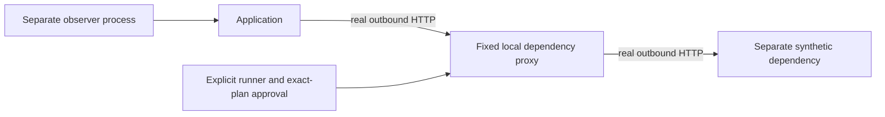

# Native HTTP dependency experiment (T4.2)

This guide describes the original T4.2 formats and unsigned observer. The distinct
[T4.3 signed native workflow](native-witness.md) adds new registration, public
approval correlation and offline mapping while preserving these commands.

Themis owns the provider-safety contract and a small native L7 fault mechanism.
It does not fork Chaos Mesh or implement a general privileged chaos engine.
This experiment supports only newly installed disposable synthetic Kind workloads.
Existing fixtures, grants, controllers, evidence formats and Chaos Mesh's denied
execution boundary keep their previous behavior.

## Actual application path



Three separate Deployments/Pods run the source-built scratch image in a uniquely
owned namespace. Each process has a random boot identity and Ed25519 key. The
dependency serves a fixed value and signs the fresh request challenge. The proxy
requests that value, verifies its exact dependency identity/signature and may add
only the approved response delay. The application really waits for its outbound
proxy call; it does not sleep in its public handler. It returns the nested signed
proxy/dependency result or a genuine dependency error/timeout.

Direct dependency, proxy dependency and application requests are distinct probes.
The observer makes all three itself, with separate fresh challenges and its own
monotonic client durations. A proxy acknowledgement or reported hold alone cannot
prove application effect. T4.2 collection is unsigned separate-process measurement;
individual fixture replies are signed. Full integration with T4.1 signed witness
registration, external trust and evidence bundles is deferred to T4.3.

## Authority and exact final target

Trusted explicit setup reads the original Kubernetes cluster/namespace,
Deployment/ReplicaSet/Pod, container, image and spec identities. It authenticates
each process's challenge response. A distinct installer key signs one complete
binding of these identities, the fixed application/dependency Pod IPs, allowed
Kubernetes actor and separate approver key. The proxy accepts this binding only
once and within 60 seconds of its own monotonic process start.

The binding must match the proxy's own Downward API Pod UID, boot and signing key.
Before binding and before Apply, the actuator itself challenges the exact fixed
application and dependency processes. An approval cannot substitute a different
binding, container, boot, upstream or application identity. The runner independently
re-reads the Kubernetes owner/spec/image chain immediately before Apply and after
measurement. No selector, replacement Pod or ambient context supplies authority.

The signed installer binding relates observed container/workload IDs to a boot key;
the process cannot externally attest its own container runtime. Downward API,
installer-controlled images, Kubernetes and the administrator remain trusted.
These checks do not protect against an administrator forging identities or stealing
keys. Same-user protected files and separate Kubernetes principals do not create
independently administered or hardware-attested actors.

`themis.native-http-plan/v1alpha1` freezes the complete binding, random run ID,
fixed delay/lifetime, application ceiling and approved scenario. Its SHA-256 digest
covers compact typed Go JSON, including the explicit version. This is not RFC8785.
Unknown, duplicate, case-aliased, null or noncanonical wire fields are denied.

Independent explicit approval of the exact digest issues
`themis.native-http-grant/v1alpha1`, one invocation and distinct random Apply and
cleanup keys. Domain-separated Ed25519 signs the complete plan and authority.
First Apply is admitted for 20 seconds; cleanup authority lasts five minutes.
Old synthetic fixture and Chaos Mesh artifacts cannot authorize this actuator.

The runner durably claims the invocation and journals intent before its single
Apply call. The actuator durably appends its own intent before changing behavior.
Each command binds action, grant, nonce and freshness. Exact duplicate Apply returns
the retained original receipt; it never changes the deadline or creates another
fault. Lost acknowledgement consumes the attempt; the runner does not retry Apply.
Remove before Apply permanently fences that invocation. Repeated Remove is
idempotent. Read-only status polling consumes no mutation capacity.

## Independent expiry and bounded operation

| Property | Supported limit |
| --- | --- |
| Additional dependency response delay | 100-200 ms; default 150 ms |
| Fault-active lifetime | 1-2 seconds; default 1.5 seconds |
| Per-request context/client deadline | 750 ms |
| Installation registration / first Apply window | First 60 seconds of proxy boot / 20 seconds from approval |
| Cleanup capability | Five minutes from approval |
| Sampling | Six seconds, at least 150 ms between sample starts, at most 55 stored samples |
| Minimum coverage | Three healthy baseline, three active effect and three recovered samples |
| HTTP body / headers / concurrency | 64 KiB / 8 KiB / 16 handlers per fixture |
| Control request / journal | 32 KiB per request/record, 512 KiB per boot |
| Retained invocations / proxy boot directories | 64 / 16; refuse capacity rather than evict replay state |
| Pod resources | Non-root, 1 CPU and 64 MiB limits per Pod; 8 MiB emptyDir declaration |

The proxy converts the remaining approval admission window once into a monotonic
local deadline, capped by the approved lifetime. A timer and every data request
enforce it independently of runner, observer, controller, API or cleanup liveness.
At expiry no new delay is introduced. Expiry/Remove interrupt an existing delay,
and any remaining wait is clipped to the deadline. Request context, transport and
server deadlines separately bound the request under the supported scheduler and
network assumptions. Already requested upstream work is not a renewed fault.

Fault state is only process-local. A restart creates a fresh key/boot, starts
unbound with no active intervention and cannot inherit an old grant. Actual
application traffic through that crashed/unbound proxy may fail. Fault expiration,
process death and end-to-end traffic recovery are separate facts.

No filesystem or network operation holds the fault-state mutex. Control mutation
has a separate gate; failed/torn/changed journal bytes poison further mutation.
Space is reserved for cleanup before another Apply is admitted. No old journal is
replayed into live fault state or silently repaired. Kernel/filesystem stalls,
host suspension, clock failure, node loss and power cuts are not absolute real-time
or availability guarantees. emptyDir's sizeLimit is kubelet-managed, not a claimed
independent filesystem quota. Fixed per-boot journal byte limits are enforced in code.

## Measurements, verdict and cleanup

The separate observer has no approval or cleanup key. It independently validates
the frozen target through its own restricted credentials and collects actual
direct/proxy/application HTTP responses through installer-pinned loopback mappings.
Those data mappings continue to work while the new owned API task is paused.
Host mapping changes cannot transfer authority: the reached actuator must still
match the exact approved boot, key, Pod and signed installation binding.

The runner requires observer readiness and makes fresh real preflight application
requests itself. Responses, challenges, boot/plan/invocation bindings, sample order,
hash chains, client durations and supported predicates are checked independently
from saved verdict strings. Source UTC is not a trusted clock.

Effect requires proxy-minus-direct client delay and signed proxy hold of at least
70% of the approved delay, together with independently measured application latency
at least 60% of that delay above maximum healthy baseline. The application response
contains its real nonce-bound proxy/dependency receipt. Recovery needs healthy
application outcomes below the approved ceiling and within 40 ms of baseline.
The application ceiling is inclusive; a duration strictly greater than it violates
the requirement. The demonstrated FAIL uses 50 ms versus the real roughly 150 ms
outbound dependency delay, while PASS uses 500 ms.

PASS requires effect, sufficient application assertion/recovery coverage, confirmed
original cleanup and current immutable identity. FAIL requires credible measured
violation with supported effect. Missing effects, no-op, incomplete observations,
ambiguous Apply or identity uncertainty yield INCONCLUSIVE. CLEANUP_PENDING remains
separate, including when application observations pass. Cancellation cannot PASS.

Cleanup requires a fresh signed response from the original proxy with the exact
invocation inactive and fenced. It uses independent cleanup authority and the
original protected plan, not a report, selector or replacement. Application or
dependency drift cannot retarget Remove. A replacement/missing original or damaged
authority remains unknown; absence is not guessed from a new proxy's reply.
Reconciliation publishes a new receipt and preserves original report/journal bytes.

The explicit `no-effect` scenario authenticates an invocation and expiry but adds
no delay. It must remain INCONCLUSIVE. `cleanup-unconfirmed` withholds state/Remove
confirmation until two seconds after local expiry; it does not disable expiry or
add another fault. Later recovery/reconciliation cannot rewrite that historical
uncertainty. These negative scenarios require the same exact-plan approval.

Offline `replay` recomputes supported chains, individual response signatures and
measurement/cleanup predicates. It cannot validate a trusted collection clock,
complete approval history or external execution root in this milestone. It always
returns NOT_INDEPENDENTLY_ATTESTED / trusted INCONCLUSIVE, including candidate PASS.
Neither a copied report nor a self-contained key becomes a trusted execution.

## Installation and CLI

Use the pinned Kind 0.32.0 tool in `.cache/tools/` and a supported explicit local
Docker named pipe or standard local Unix socket. Remote Docker endpoints are
denied; the original engine and Kubernetes UIDs are checked before installer
mutations. No existing workload or cluster is adopted. Run PowerShell scripts with
an appropriate per-process execution policy; no global policy change is required.

```powershell
$clusterName = 'themis-t42-' + [guid]::NewGuid().ToString('N').Substring(0,12)
./scripts/kind-dependency.ps1 -Action up -ClusterName $clusterName
go build -trimpath -o bin/ ./cmd/...
$state = Join-Path (Get-Location) ('.themis/' + $clusterName)
bin/themis-dependency plan --state "$state/runner" --directory "$state/my-run" --max-application-ms 500
# Review the complete printed plan and exact digest before issuing approval.
bin/themis-dependency observe --state "$state/observer" --plan "$state/my-run/plan.json" --observations "$state/my-observations"
# In another terminal, after durable ready.json exists:
bin/themis-dependency approve --directory "$state/my-run" --keys "$state/keys" --approve-digest sha256:EXACT_REVIEWED_DIGEST
bin/themis-dependency run --state "$state/runner" --directory "$state/my-run" --observations "$state/my-observations"
bin/themis-dependency inspect --state "$state/runner" --directory "$state/my-run"
bin/themis-dependency reconcile --state "$state/runner" --directory "$state/my-run"
./scripts/kind-dependency.ps1 -Action down -ClusterName $clusterName
```

Use `.exe` on Windows. `cancel` accepts the same state/directory flags as reconcile.
`replay --plan PUBLIC_REPORT.json` is read-only and offline. Existing reports,
claims and sessions cannot be replaced. Private state and keys remain under .themis.
`refresh` is a trusted installer operation for a genuinely new owned proxy boot;
it does not transfer old plans/grants or restart a completed experiment.

| Command result | Native child exit |
| --- | --- |
| Successful setup/plan/approval/observation/action or measured PASS | 0 |
| CLI usage / failed output write | 2 / 3 |
| Measured source FAIL | 4 |
| Authority/input denied / failed execution attempt | 5 / 6 |
| Cleanup pending / INCONCLUSIVE or offline untrusted replay | 7 / 8 |
| Cancelled run | 9 |

Live opt-in tests need explicit `THEMIS_NATIVE_DEPENDENCY=1`, protected state,
executable and public evidence paths (`THEMIS_NATIVE_DEPENDENCY_STATE`,
`THEMIS_NATIVE_DEPENDENCY_BINARY`, `THEMIS_NATIVE_DEPENDENCY_EVIDENCE`). The normal
suite skips them; skips are not live evidence. Trusted lifecycle tests kill only
their actual child handle or exact owned container/task, delete only an owned Pod
with a UID precondition, and pause/resume only the new owned API. They preserve
real disruption and failed attempts. See the milestone handoff for observed runs.

## Privileges and deferred work

Data Pods have no API token, privilege, host network/PID, host mount, exec feature,
network-control capability or general proxy API. Application egress dials only its
fixed proxy service IP; proxy egress dials only its bound dependency IP, with two
fixed peer identity checks during registration/Apply. Redirects, proxies and
arbitrary upstream URLs are disabled. This is a code-enforced synthetic path, not
CNI/network-policy enforcement against a malicious administrator or modified image.

Runtime Kubernetes permissions are named identity reads, SelfSubjectReview and
exact-name forwarding. No workload/Secret reads beyond the declared resources,
patch/delete/create workload permission or broad selector/list is granted. The
existing Themis controller Role remains unchanged and cannot execute native faults.
Installer credentials and tightly guarded destructive tests are separate from
runner/observer credentials. Same OS user/admin provisioning remains an explicit
trust limitation.

The old Chaos Mesh UID/independent-expiry blockers remain unresolved for that
provider. This different L7 mechanism does not prove arbitrary network fault
safety. No kernel interception, production support, database fault, provider SDK,
full witness bundle integration or trusted execution attestation is introduced.
See [roadmap](roadmap.md) and ADRs T084-T089.
